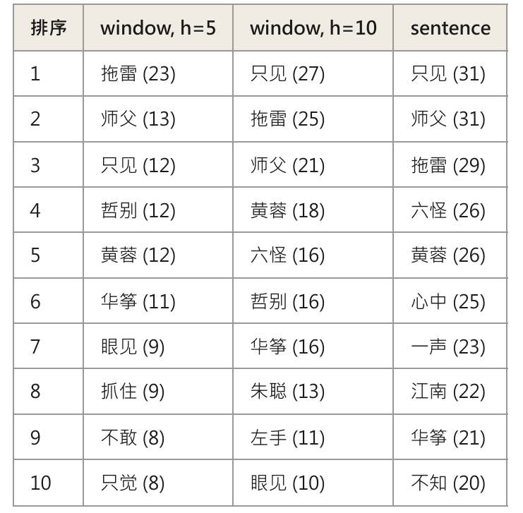

# 以搭配詞操作「人物空間」：《射鵰英雄傳》第一卷中的郭靖

Woloch 在《獨與眾》（The One vs. the Many）中提出「人物空間」的觀點，説明人物在叙事中僅占據有限的位置，而其人物形象、功能則由其被假設的完整生命與敘事實際分配給該人物的篇幅、視角共同組合。本文試圖探討「人物空間」是否能通過統計方法操作化？其怎樣説明角色在受篇幅、視角等影響下而形成的功能和空間？「人物空間」概念又有怎樣的局限？以下本文將利用語料庫及搭配詞方法，來考察文本中的「人物空間」概念。

本報告的語料為金庸著作《射雕英雄傳》第一卷，取自CHI 3242 課程提供數據倉庫 mcjkurz/qhchina-data，檔案為 corpora/中文小说100强/29_射雕英雄传一.txt。文本含第一回「風雪驚變」至第十回「冤家聚頭」，約19.7萬中文字，在分句、分詞後發現共約11.5萬詞（token）、2 萬詞種（type）及6926個句子（sentences）。本報告的目標詞為「郭靖」。《射雕英雄傳》第一卷涵蓋郭靖從遺腹孤兒到初入中原的成長弧線，郭靖作爲全書的主角，出現次數固然是最多、最顯眼的。在經預處理的六千九百二十六句分詞語料中，郭靖出現五百六十五次，遠高於其他候選角色（黃蓉一百二十九、梅超風一百六十九、小王爺七十二、楊康十九），因此本文認爲選擇郭靖為目標角色樣本量最充足。

建立語料庫及搭配詞分析的步驟為：使用Jieba為分詞工具，因Jieba分析簡體字比繁體字更好，故先以 OpenCC 將全文轉為簡體，以確保更穩定、更匹配的搜索結果，再按句末標點「。！？」分句。斷詞以 jieba 分詞並濾除標點符號。此外，分句設置剔除詞數少於五的句子，以確保不被對話碎片污染統計結果。分析使用“qhchina.analytics.collocations”的“find_collocates”；Find_collocates 對每個候選詞建立 2×2 列聯表（該詞是否出現在郭靖語境中 × 語境内外的樣本量），以 Fisher 精確檢定計算兩者獨立時觀察到目前或更極端共現次數的機率，即 p 值。檢定方向使用alternative=“greater”，即只檢定「共現高於隨機預期」；設定上選擇剔除預設的「停用詞」（的、是、在 等）以更準確地搜索其他意義更大的詞彙，只保留至少兩字的詞以聚焦雙字詞，將檢定的p值設為0.05(即5%以下)，過濾掉那些本身就常隨機出現在全文中的詞，只保留比隨機出現更顯著出現在郭靖身邊的搭配詞。以上設定為確保統計結果中沒有出現無意義的詞，且統計結果均為與郭靖共現的頻率顯著高於隨機預期的詞。

根據上述設定，本文就「郭靖」一詞運行搭配詞分析，結果表中obs_local 為實際共現次數， exp_local 為假設的期望共現次數，而ratio_local （obs除以exp）為實際共現次數與期望共現次數的比例，其大於1 表示該詞更顯著被「吸引」到目標詞附近。為檢驗結果，本文以三組搭配詞分析分別為 window 法 horizon=5 與 horizon=10（檢索「郭靖」一詞在句内的前後5詞及前後10詞），以及 sentence 法（檢索「郭靖」一詞出現的整句）。三組結果由緊到鬆：H5 只看緊貼目標詞的搭配，sentence 把整句視為語境。全部結果經 obs_local 由高至低排序。

三種設定分別得到 417（h=5）、160（h=10）、289（sentence）個搭配詞。前十名如下：

這些詞大約可分三類：

- 人物：拖雷、哲別、黃蓉、華箏、六怪、師父、朱聰

- 動作：只見、眼見、抓住

- 心理：心中、不知、只覺

上表可見，H5、H10及Sentence的相同點在於人物的高頻出現：三組中，人物均占多數（H5中5個、H10中7個、Sentence中5個），説明人物為郭靖最常見的搭配詞。不同之處在於H5中榜單第一的為人物「拖雷」且遠遠領先其餘搭配詞，而在H10及sentence中榜單第一的為動作「只見」，這説明拖雷與郭靖進行的互動密集往往發生在短距離對話中。這些人物類搭配詞幾乎表示了前十回郭靖的人物關係網，説明郭靖被哪些人所包圍。

該表亦顯示出文本敘事視角。如只見、眼見、心中、心想、不知等敘事視角詞與郭靖為高頻搭配詞，説明前十回的視角人物長期停留在郭靖身上，文本通過郭靖所見所想開展，體現Woloch所説的人物由其生命與敘事實際分配給該人物的篇幅、視角共同組合。文本分配了大量的敘事視角詞予郭靖，郭靖因此有更寬闊的人物空間。

回到Woloch的「人物空間」理論，其主張人物重要與否不是印象問題，而是敘事資源分配的結構問題。本文認爲敘事資源分配可通過統計而變爲可測量的事實。郭靖擁有 289–417 個顯著搭配詞，且其空間中充滿敘事視角詞，直接説明郭靖為本文第一主視角。更顯著的印證來自對其他目標詞的嘗試，本文嘗試以「黃蓉」、「小王爺」、「六怪」、「師父」作爲目標來檢索搭配詞，發現郭靖均名列前茅，在「黃蓉」中的H5、H10、sentence甚至都是第一位。通過交叉驗證，搭配詞能清晰驗證文本將敘事資源重點分配給了哪個人物，在《射雕英雄傳》第一卷中便是郭靖。通過對主角郭靖的搭配詞研究，也能觀察出文中次要人物如何被功能化為主角故事線上的節點，如在人物搭配詞排序較後的哲别、穆易、馬鈺等。

此外，本文認為通過數據統計方法可以清晰觀察敘事資源分配給人物怎樣的關係網、行爲及空間，如郭靖身邊的拖雷、哲別、黃蓉、華箏、六怪、師父、朱聰等人。通過排序可以得知郭靖與人物的親密關係程度，如前十回在H5、H10及sentence都處於前三位中的拖雷和師父可預計是與郭靖最親密的人。但只憑搭配詞來理解人物關係網並不足夠。我們僅能得知郭靖身邊的人物及他與誰互動較密集，但卻無法從中分別這些關係實際的分佈和網絡。如郭靖前十回實際處於蒙古網（拖雷、哲别、華箏）、師傅網（師父、六怪）及中原網（黃蓉、穆易、江南）。僅憑分析郭靖的搭配詞僅僅將分析文本中的所有語境混雜計算，卻無法得知郭靖人物空間構成的性質與方向。

方法上，用搭配詞分析的一大問題在分詞上。Jieba分詞將對話標記如「道」、「笑」、「見」等説話動作與進行動作的人物黏成一詞。這個情況在郭靖和黃蓉身上尤爲嚴重：郭靖真實出場次數為1058次，但Jieba僅計算565次「郭靖」，其餘493次為「郭靖道」等詞；黃蓉出場次數264次，但Jieba僅計算129次「黃蓉」，其餘135次為「黃蓉道」等詞。這顯示主要人物的空間被嚴重低估，如郭靖和黃蓉被低估47%和51%，但柯镇恶、梅超風等次要人物則完全沒被低估。各角色被低估的比例不同，人物空間的互相比較因此失真，而受影響最多的恰是對話最多的主要角色。主要角色説得越多，越活躍，在統計上反而越受到壓縮，因此以此進行統計未必準確。

此外，名字的環境不等於人物空間本身。本文測試的目標為「郭靖」，但小説中郭靖大部分出場是以代詞「他」指稱的，而停用詞過濾則把「他」刪掉了。因此本分析系統性地低估每個人物獲得的敘事注意力，且低估幅度因人物而異。Woloch 的人物空間是「被暗示的人」與「話語分配的篇幅」的交會，代詞指稱屬於後者，卻不在名字搭配詞的測量範圍內。Woloch 強調次要人物常「暗示」比文本給予空間更豐富的內在生命——穆易作為楊鐵心的悲劇厚度、華箏的等待，這種「被暗示的深度」在搭配詞表上完全不可見；我們只看到穆易與郭靖同句13次的統計結果。統計能指出「哪裡有人物空間」，卻無法告知空間裡暗示了什麼。

結論是，搭配詞分析確實可以把 Woloch「人物空間」理論變成可統計的數字，它以郭靖為單一目标，刻畫出敘事分配給他的那塊位置由誰、由何種方式填滿。此外，通過分析次要人物空間對主角的依附，也能支持人物系統作為不均分配結構的主張。但搭配詞分析的局限亦清晰，其善於回答「誰與郭靖共享空間、更親密」，卻不善於回答「他們是什麼關係、關係如何隨時間與敘事展開」。其無法測試代詞，同時亦有許多失真誤差。讀者仍須回到細讀與理論。
